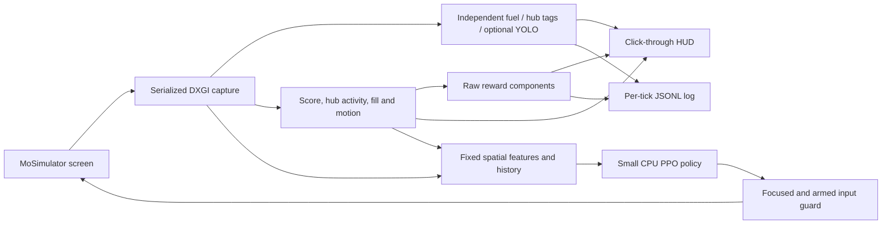

# Architecture

CroSim Vision observes the rendered game using Windows DXGI capture. Human
watch mode shares the existing environment's score, hub, fill, motion and reward
logic with a separate live detection worker.

## Keeping boxes current

The vision worker requests fresh frames independently of reward observation.
Slow score OCR therefore does not hold back the next fuel image. Native DXGI
surface access is serialized so the environment and worker cannot map it
simultaneously. No unbounded image queue accumulates behind inference.

The default maximum detection rate is 20 Hz, and the overlay attempts up to
30 redraws per second. Actual rates depend on the machine and game load. The
HUD shows capture age and processing time; color boxes expire after 0.25 seconds
and optional YOLO boxes after 0.8 seconds. Cached unchanged frames retain their
original capture timestamp. Hub anchors also carry their own timestamps and
expire after 0.4 seconds; an updated fuel frame cannot refresh an old marker.

An earlier color-only replay measured roughly 2 ms per fuel pass. The
zone-aware reference-frame pass, including marker decoding and pose hypotheses,
measured about 28–45 ms on the development machine. These are offline observations,
not guaranteed live-game latency measurements.

## Detection sources

The default fuel path downsizes to at most 960 pixels wide, thresholds the
configured yellow range in HSV, excludes calibrated HUD/hopper regions, and
returns connected-region boxes. These are explicitly labeled color candidates.
Overlapping balls can form one region. Up to 100 color candidates are currently
returned; optional YOLO inference requests up to 300 detections.

The zero-label path also decodes 36h11 AprilTags on the blue and red hubs.
Only official hub IDs are accepted; nearby trench/outpost/tower tags are not
hub anchors. Boxes enclose the decoded markers, not the entire hub. The feature
agent uses the requested alliance's marker position and apparent size, with
missing/stale markers explicitly absent. Camera pose and metric range are not
inferred by the hub feature slots. A separate conservative zone filter estimates
camera/ground-projection hypotheses from a fresh field-marker pair. Opponent
and unverified fuel is removed before the learner's grid, nearest target and
cluster calculation. The HUD marks excluded candidates gray. Both color and
optional YOLO fuel paths use the restriction; ambiguous geometry does not reuse
an old zone projection or default to allowing all fuel.

`mosim_field.py` reuses these camera hypotheses to project the robot's lower
basket anchor onto the floor. A rear-to-center allowance and the full hypothesis
range produce estimated position bounds. Chase-view bearing supplies an
explicitly approximate heading. `mosim_minimap.py` draws these estimates beside
the reward HUD, including uncertainty, last-seen behavior and optional peers.
The feature vector and policy architecture remain unchanged. The field pose
feeds an additive, confirmed red-zone entry/occupancy cost; uncertain or stale
pose evidence cannot charge it. V3 learned checkpoints support this additive
reward upgrade without reinitializing weights or optimizer state.

Custom YOLO inference is optional and consumes the full BGR frame. Weights must
include `fuel`, `blue_robot`, `red_robot`, and `hub`. Generic pretrained model
classes do not satisfy this contract.

The score, hopper and hub-indicator outlines are configured reading regions,
not object detections. Hub activity combines calibrated indicator color with
the match schedule. The displayed match clock is estimated rather than OCR-read.

## Reward observability

Every environment step exposes signed `reward_components`, `reward_reasons`,
`reward_total`, running `episode_return`, and diagnostic values. The ledger groups
continuous repetitions on screen while logging every step separately.

Logs include confirmed and pending score, OCR failures, potential before/after,
camera rebaseline state, key transitions/conflicts, motion, hub source, fill and
the latest asynchronous vision result. Vision and reward frames can differ;
timestamps make that distinction explicit.

## Windows overlay and input

Tk rendering belongs to a dedicated thread. The overlay verifies Windows display
affinity exclusion before showing its content and uses transparent, tool-window
and no-activate styles. Tk's bootstrap focus is restored before the overlay is
shown. Borderless/windowed mode is required for reliable visibility over the game.

The input guard polls global bracket keys independently of inference. It checks
foreground titles, recognizes both MoSim and MoSimulator, and pauses on focus
loss. Watch mode never injects actions or match resets. Agent modes share a lock
between key injection and release so stop/focus-loss cannot race a new key press.

The original pixel-policy observation remains available for existing agent
commands, with the movement bonus removed and camera slot rebound to H. The
separate `crosim_agent` path supplies 95 fixed features per tick and three ticks
of history to a CPU MLP. Eighteen discrete actions cover intake movement,
search/aim, approach, shooting, hopper toggle and strafing without intake.
Collection/return labels supply advisory targets while the learned policy keeps
multiple movement choices and access to Space. Scoring and recovery suggestions leave the policy free to choose actions. Observation-carried masks enforce opponent-fuel and camera-settling limits in both sampling and PPO evaluation.
The HUD displays the guidance, sensor basis and permitted actions. Live training
continues across automatically restarted matches and checkpoints completed
updates periodically. Timer OCR triggers restart three seconds after zero; an
independent 165-second wall-clock watchdog recovers missed end frames. Capture
stalls release inputs and wait for fresh data or the watchdog rather than
aborting before a reset can occur.
The learner uses asynchronous score OCR with a timeout, bounded potential-based
guidance and shoot-correlated score credit. Its reward labels are passed to the
same ledger and renderer; `agent watch` exposes those rewards during human play.

An automatic heuristic/bootstrap and randomized practice environment provide
initial weights without user demonstrations. Proxy training never opens capture
or sends keys. Checkpoint domains and schema fingerprints distinguish that
initialization from real-screen learning. See [training](training.md) and
[design/evidence](learning-design.md) for timing, rewards and validation limits.

The retained-pose revision holds the last position between covariance-weighted
vision corrections, without a gyro/encoder feed. Guidance inputs are scaled to
40%, and shot/recovery overrides are removed. The action distribution mixes
55% learned policy, 40% sensor-based guidance and 5% legal exploration, including
during PPO log-probability evaluation. A three-second hopper-toggle cooldown
prevents the repeated-toggle stall. Existing weights and optimizer
state continue through the supported controller upgrade. Each HUD panel has an
independent persisted position and a draggable title bar.

The compact ledger keeps totals, control/shift state and recent rewards. A
retained region tracker sits beneath the minimap. Fresh conservative blue-zone
bounds and the visually observed shift arrow enable the -0.10/s wrong-zone
reward after a two-second shift-change grace. Scoring pays 3.6 per point. The
reward-schema migration preserves policy tensors and optimizer state.

Score-first revision: every confirmed alliance score increase pays 3.6 per point, without a shooting-window filter (including teammate points). OCR requires two agreeing numeric layouts and temporal confirmation; pending final score reads are drained before a live reset. Hopper potential is 0.20 and fuel-target potential 0.05. Turning costs 0.60/s after grace; continuous turns are masked after 1.6s until 0.6s translation. Estimated blue-bump contact costs 0.80/s after 1.5s crossing grace; red hub/bump/trench proximity costs 0.40/s after confirmation. These contact proxies require fresh tight pose bounds and nominal FIRST geometry; they are not collision telemetry. Existing model weights continue unchanged.

Human demonstrations use reaction-aligned feature histories and exact categorical macro labels, preserving unsupported raw combinations without rounding them. Actor-only supervised fitting uses complete-match holdout validation, restores the best actor, and clears stale actor optimizer moments. It retains the value network, steps and PPO resume path. Human baselines use 10% controller guidance, 5% random exploration and 85% learned behavior; autonomous PPO can subsequently improve the same weights. Camera-action schema migration expands old network input columns/output rows and corresponding Adam moments without deleting prior weights.

Bidirectional pose update: normal and reversed H views both localize after the brief camera-settling period. Switching views clears old tracked tag corners but retains the robot pose/trail and covariance. Reversed camera bearing is corrected by 180 degrees to preserve robot heading. Joint fitting uses tags across hub/field/alliance groups when reprojection checks succeed, with pair fallback otherwise. Remaining camera ambiguity and contact-anchor uncertainty stay visible in the pose bounds; no artificial reduction of confidence bounds is applied.
